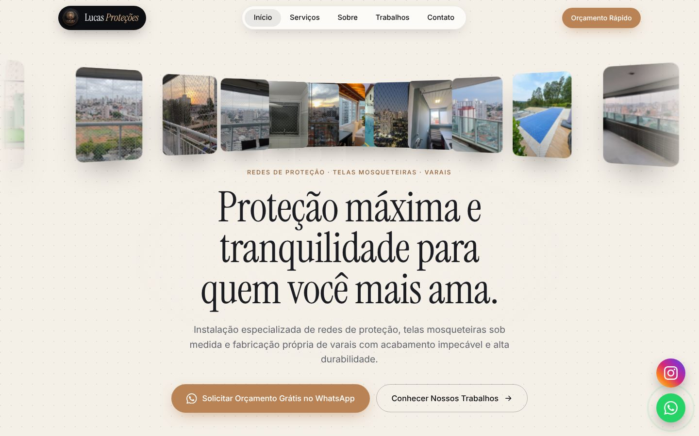
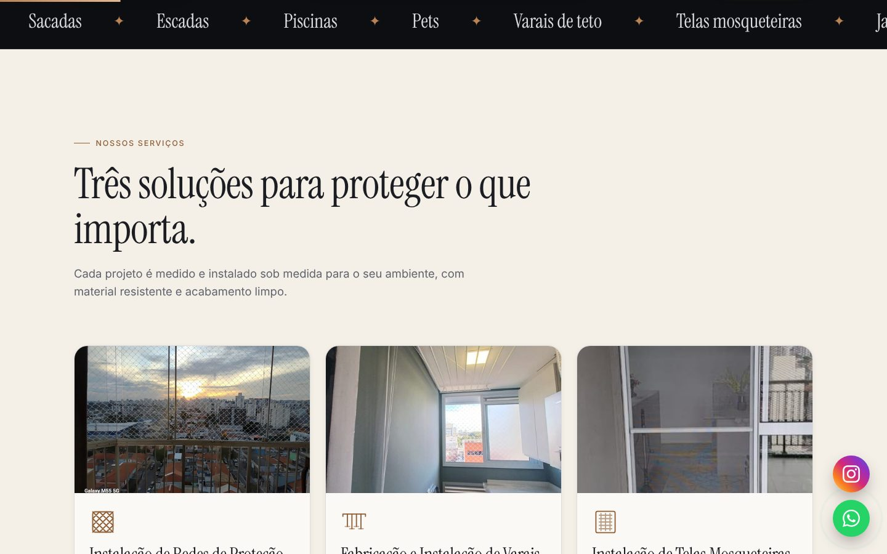
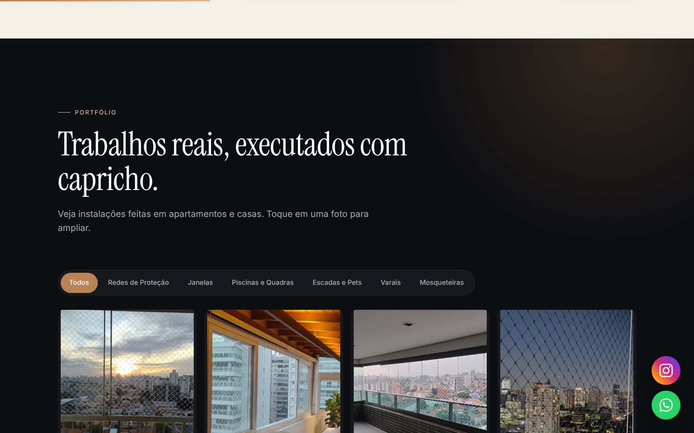
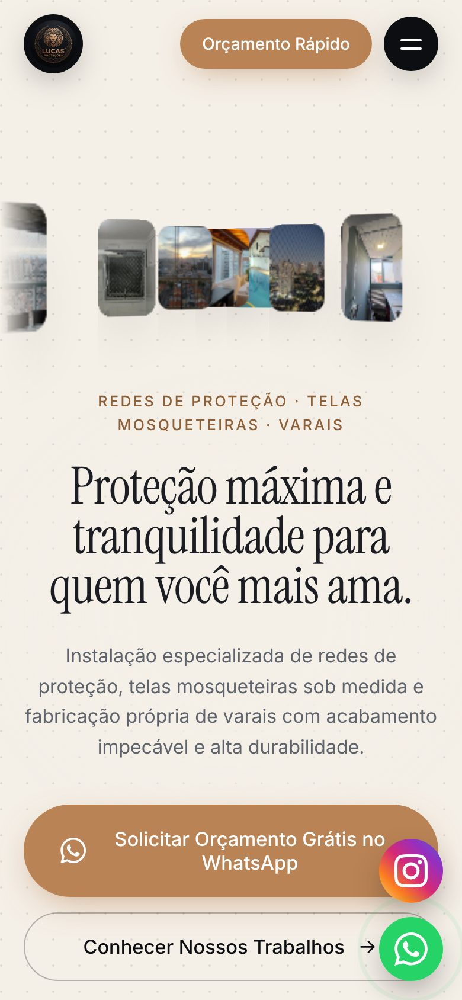

<div align="center">


# Lucas Proteções — Site Institucional

**Redes de proteção · Telas mosqueteiras · Varais sob medida**

Site institucional moderno, rápido e 100% responsivo, com animações inspiradas no [Melius](https://www.melius.com/) e foco em conversão via WhatsApp.


</div>

<p align="center">
  
</p>

---

## 📑 Sumário

- [Visão geral](#-visão-geral)
- [Principais recursos](#-principais-recursos)
- [Pré-visualização](#-pré-visualização)
- [Tecnologias](#-tecnologias)
- [Estrutura do projeto](#-estrutura-do-projeto)
- [Como executar](#-como-executar)
- [Personalização](#-personalização)
- [SEO](#-seo)
- [Acessibilidade e desempenho](#-acessibilidade-e-desempenho)
- [Publicação (deploy)](#-publicação-deploy)
- [Boas práticas adotadas](#-boas-práticas-adotadas)
- [Checklist antes de publicar](#-checklist-antes-de-publicar)
- [Licença e créditos](#-licença-e-créditos)

---

## 🎯 Visão geral

Projeto de site institucional para a **Lucas Proteções**, empresa especializada em instalação de redes de proteção, telas mosqueteiras e fabricação de varais. O objetivo é transmitir **segurança, confiança e agilidade**, levando o visitante a pedir um orçamento pelo WhatsApp.

O projeto é feito apenas com **HTML, CSS e JavaScript puros** — sem frameworks, sem bundler e sem etapa de build. Basta abrir o `index.html`.

## ✨ Principais recursos

| Área | O que oferece |
| --- | --- |
| **Hero** | Túnel 3D de fotos reais (abertura animada, deriva contínua, reação à rolagem e ao mouse) e título revelado palavra por palavra |
| **Animações** | Scroll reveal com curvas `cubic-bezier`, botões com preenchimento no hover, botões magnéticos, brilho que segue o cursor nos cards, parallax, marquee, barra de progresso de leitura |
| **Header** | Pílula flutuante que esconde ao rolar para baixo e reaparece ao subir; menu mobile em tela cheia |
| **Tema claro/escuro** | Botão no header com animação de **círculo expansivo** (View Transitions API), escolha salva no navegador e sem "flash" ao carregar |
| **Botões de orçamento** | Brilho dourado animado (faixa de luz + halo pulsante) para chamar atenção |
| **Serviços** | 3 cards com botões que abrem o WhatsApp com **mensagem pré-definida por serviço** |
| **Galeria** | 46 fotos reais, filtro por categoria (abas com indicador deslizante), paginação "Ver mais" e **lightbox** (teclado, swipe e pré-carregamento) |
| **Conversão** | CTAs em todas as seções + 2 botões flutuantes (WhatsApp com pulsação e Instagram) |
| **Conteúdo** | Sobre, "Como funciona", depoimentos, FAQ e CTA final |
| **SEO** | HTML5 semântico, meta tags, Open Graph, dados estruturados (JSON-LD), `alt` descritivos, `loading="lazy"` |

## 🖼️ Pré-visualização

<p align="center">
  
  
</p>
<p align="center">
  
</p>

## 🛠️ Tecnologias

- **HTML5** semântico (`header`, `main`, `section`, `article`, `footer`, `nav`)
- **CSS3**: variáveis (custom properties), Grid, Flexbox, `clip-path`, transformações 3D, `backdrop-filter`
- **JavaScript (ES5, IIFE)**: `IntersectionObserver`, `requestAnimationFrame`, `matchMedia`
- **Fontes** hospedadas localmente: [Instrument Serif](https://fonts.google.com/specimen/Instrument+Serif) e [Inter](https://rsms.me/inter/) (licença SIL OFL)
- Ícones em **SVG sprite** inline (WhatsApp e Instagram: paths do [Simple Icons](https://simpleicons.org/))

## 📁 Estrutura do projeto

```text
lucas-protecoes/
├── index.html              # Página única com todas as seções
├── css/
│   ├── fonts.css           # @font-face (fontes locais)
│   ├── variables.css       # Tokens: cores, fontes, espaçamentos, curvas e temas claro/escuro
│   ├── base.css            # Reset, tipografia, utilitários
│   ├── components.css      # Header, botões, seções e componentes (BEM)
│   └── animations.css      # Keyframes e estados de animação
├── js/
│   ├── config.js           # ⚙️ Telefone, Instagram e mensagens do WhatsApp
│   ├── theme.js            # Alternância de tema claro/escuro (com animação)
│   ├── main.js             # Links dinâmicos, menu, scroll suave, header, scroll spy
│   ├── animations.js       # Reveal, título por palavras, túnel 3D, microinterações
│   └── gallery.js          # Filtro, paginação e lightbox
├── fonts/                  # Instrument Serif e Inter (.woff2)
├── img/
│   ├── logo/               # Logotipo (variações otimizadas e favicon)
│   └── obras/              # Fotos dos trabalhos (+ thumbs/ para o grid)
└── docs/screenshots/       # Imagens usadas neste README
```

## 🚀 Como executar

Não há instalação. Escolha uma opção:

```bash
# 1) Abrir direto no navegador
#    dê dois cliques em index.html

# 2) Servidor local (recomendado — reproduz melhor o ambiente real)
python3 -m http.server 8000      # depois acesse http://localhost:8000
# ou
npx serve .
```

## 🎨 Personalização

### Telefone, Instagram e mensagens do WhatsApp
Edite **apenas** `js/config.js`:

```js
window.SITE_CONFIG = {
  whatsappNumber: "5511999999999",                      // 55 + DDD + número
  instagramUrl: "https://www.instagram.com/seu_perfil",
  mensagens: { rede: "Olá! ...", varal: "Olá! ...", /* ... */ }
};
```

Para um botão usar uma mensagem, adicione `data-wa="chave"` ao link no HTML (ex.: `data-wa="rede"`).

### Cores, temas e fontes
Todas as cores e curvas de animação estão em `css/variables.css`. Os **tokens semânticos** (`--bg`, `--surface`, `--text`, `--muted`, `--accent`…) mudam automaticamente no tema escuro (`:root[data-theme="dark"]`); nos componentes use sempre esses tokens, nunca cores fixas. O tema padrão é o claro e a escolha do visitante é salva em `localStorage` (`lp-theme`).

```css
:root {
  --ink: #0d0e11;     /* preto do logotipo */
  --bronze: #b98355;  /* cor de marca / CTAs */
  --cream: #f4efe7;   /* fundo claro */
}
```

### Fotos da galeria
1. Otimize a imagem (ideal: lado maior ≤ 1500 px, JPEG ~80%) e uma miniatura de ~720 px.
2. Salve em `img/obras/` e `img/obras/thumbs/` com o mesmo nome.
3. Copie um bloco `<li class="gallery__item" data-cat="...">` em `index.html` ajustando `src`, `data-full` e `alt`.

Categorias disponíveis: `redes`, `janelas`, `piscinas`, `escadas`, `varais`, `mosqueteiras`.

### Brilho dourado dos botões
Adicione a classe `btn--shine` a qualquer botão. Velocidade e cores estão em `css/animations.css` (`@keyframes gold-shine` e `gold-glow`) e nos tokens `--gold` / `--gold-deep`.

### Intensidade do túnel 3D
Velocidade, suavização e duração da abertura ficam no objeto `TUNNEL` no topo de `js/animations.js`. O **tamanho das fotos** é definido na linha `geo.ch` da função `measure()`.

### Depoimentos
Os três cartões em `index.html` (seção `#depoimentos`) são **modelos marcados com “[MODELO]”**. Substitua por depoimentos reais e autorizados.

## 🔎 SEO

- `<title>` e `meta description` otimizados para os serviços
- Hierarquia única de títulos (`h1` → `h2` → `h3`)
- Open Graph e Twitter Card para pré-visualização em redes sociais e WhatsApp
- JSON-LD (`HomeAndConstructionBusiness`) — adicione `telephone` e `address` reais
- `alt` descritivo em todas as imagens e `loading="lazy"` na galeria
- Atualize `canonical` e `og:url` para o domínio final; para o `og:image` use URL absoluta

## ♿ Acessibilidade e desempenho

- Tema claro/escuro com `color-scheme`, contraste revisado nos dois temas e `aria-pressed` no botão
- Respeita `prefers-reduced-motion` (animações desligadas para quem prefere)
- Navegação completa por teclado, foco visível, *skip link*, ARIA nas abas, menu e lightbox
- Contraste adequado e alvos de toque ≥ 44 px
- Túnel 3D **pausa fora da tela**; scroll listeners `passive` agrupados por `requestAnimationFrame`
- Imagens otimizadas (~11 MB no total, com miniaturas para o grid) e carregamento *lazy*
- Fontes locais com `font-display: swap` e `preload`
- Zero dependências de terceiros em tempo de execução

## 🌐 Publicação (deploy)

**GitHub Pages** (gratuito):

```bash
git init
git add .
git commit -m "feat: site institucional Lucas Proteções"
git branch -M main
git remote add origin https://github.com/<usuario>/<repositorio>.git
git push -u origin main
```

Depois, no GitHub: **Settings → Pages → Source: Deploy from a branch → `main` / root**.
Alternativas: Netlify, Vercel, Cloudflare Pages (arraste a pasta ou conecte o repositório).

## 🧱 Boas práticas adotadas

- **Mobile-first** com breakpoints `min-width`
- **CSS organizado em camadas** (fontes → tokens → base → componentes → animações) e nomenclatura **BEM**
- **Design tokens** em variáveis CSS — nenhuma cor “solta”
- **JavaScript modular por responsabilidade**, funções pequenas, constantes nomeadas e **JSDoc**
- **Separação de configuração e código** (`config.js`)
- **Melhoria progressiva**: sem JS, o conteúdo continua visível (`.js` é adicionado ao `<html>` só quando o script roda)
- Todo o código **comentado em português**, com índice no topo de cada arquivo
- `.editorconfig` para padronizar o estilo entre editores

## ✅ Checklist antes de publicar

- [ ] Trocar número do WhatsApp e link do Instagram em `js/config.js`
- [ ] Substituir os depoimentos-modelo por reais
- [ ] Atualizar `canonical`, `og:url`, `og:image` e JSON-LD com domínio/telefone/endereço reais
- [ ] Conferir cidade/região de atendimento nos textos e nos `alt`
- [ ] Confirmar as afirmações comerciais (ex.: “resistência certificada”)
- [ ] Testar no celular e rodar o Lighthouse

## 📄 Licença e créditos

© Lucas Proteções. Todos os direitos reservados — o conteúdo (textos, logotipo e fotos) pertence à empresa. Defina a licença do **código** conforme sua preferência antes de tornar o repositório público (por exemplo, MIT).

Desenvolvido por [Bruno Carvalho](https://www.linkedin.com/in/bruno-carvalho-silvaa/).

Créditos: fontes Instrument Serif e Inter (SIL OFL); ícones de marca via Simple Icons (CC0); inspiração de animação: Melius.
